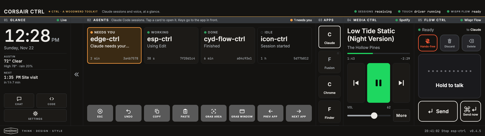

# Corsair Ctrl

A touch panel for the CORSAIR XENEON EDGE 14.5" LCD Touchscreen (2560 × 720), for working at a Mac with less keyboard. It shows which Claude Code sessions need you and opens them, switches apps, controls music, sends a few everyday keys, and carries the Flow Ctrl voice buttons for Wispr Flow. Mac only. Part of the WOODWERD Ctrl family.



Unofficial. Not affiliated with or endorsed by Corsair, Anthropic, Wispr, Spotify or Apple. See the [notices](THIRD_PARTY_NOTICES.md).

## The panel, area by area
The panel never takes focus. Whatever app you were working in stays in front, so keys and dictation land there.

**01 Glance.** Clock, date, weather and your next calendar event. **Chat** and **Code** start a new chat or a new Claude Code session in the Claude desktop app. **Settings** opens the settings sheet.

**Fold rail.** The narrow strip with the double arrow folds the panel down to Glance alone. The rest of the Corsair then works as a normal screen. Tap it again to bring the panel back.

**02 Agents.** One card for each of the last eight Claude Code sessions. Tap a card to open that session in Claude. A card is in one of four states:

- **Needs you** (orange): Claude is waiting on a permission or an answer.
- **Working**: Claude is running.
- **Done**: Claude finished and is waiting for your next prompt. Tapping the card sets it back to Idle.
- **Idle**: nothing is happening.

**Key row.** Eight keys under the cards: Esc, Undo, Copy, Paste, Grab area, Grab window, Prev app, Next app. The first four go to the app in front. The grabs press your Mac's own shortcut for copying a screen area to the clipboard, whatever it is set to in Keyboard settings: drag an area, or click a window, with the mouse, then paste. Prev app and Next app page through every open app, one per press, most recently used first; pause four seconds and it starts over.

**03 Apps.** Four pinned apps, then every other open app, most recently used first. Tap one to bring it forward. Drag the strip to scroll.

**04 Media Ctrl.** What is playing in Spotify or Apple Music, with previous, play or pause, next, volume, and a **More** view (skip 15 seconds, shuffle, repeat, like, mute). The accent follows the player: green for Spotify, red for Music. With neither playing, the buttons send the system media keys.

**05 Flow Ctrl.** Voice through Wispr Flow. **Hold to talk** dictates while your finger is down. **Hands-free** starts dictation that runs until you stop it. **Send** presses Return, **Send now** presses Command-Return, **Discard** presses Esc, and **Delete** removes one character backwards and repeats while held, for taking back the end of what you just said.

## Works with
- **Display:** the CORSAIR XENEON EDGE 14.5" LCD Touchscreen, at its native 2560 × 720. The panel is drawn for that screen and no other.
- **Computer:** a Mac, macOS 14 or later. Not Windows.
- **Touch:** Corsair's iCUE software does not run on a Mac, so touch comes from the separate driver listed under Needs.
- **Tested on:** one Mac and one XENEON EDGE, the black one. Corsair sells it in other colours; those have not been tried.

The app finds the Corsair by its shape, the very wide screen, not by its name. It has not been tried with any other wide display.

## Needs
- macOS 14 or later, with Xcode or the Command Line Tools.
- The Corsair connected for picture and USB, set to its native 2560 × 720.
- The touch driver: [ajvwhite/MacXeneonEdgeTouchDriver](https://github.com/ajvwhite/MacXeneonEdgeTouchDriver), installed with its `Scripts/install.sh` and allowed under Accessibility and Input Monitoring.
- Wispr Flow, with push to talk set to Ctrl + Opt + T (the same chord as CYD Flow Ctrl).
- For Media Ctrl's track info: Spotify or Apple Music. Anything else gets media keys only.

## Install
Each command, in order:
```
git clone https://github.com/WOODWERD/corsair-ctrl.git ~/Code/corsair-ctrl
bash ~/Code/corsair-ctrl/app/build.sh
open "$HOME/Code/corsair-ctrl/app/build/Corsair Ctrl.app"
```
The first copies the project to `~/Code/corsair-ctrl`. The second compiles and signs the app; nothing is installed outside that folder. The third starts it.

**Signing.** The build signs with the first "Apple Development" certificate in your keychain, or the one named in `CODESIGN_IDENTITY`. With no certificate it signs ad hoc, which works, but macOS then treats every rebuild as a new app and asks for Accessibility again each time.

The panel appears on the Corsair. With no Corsair attached it stays hidden rather than cover another display.

To quit: Settings > Quit on the panel, or `pkill -x CorsairCtrl`.

## First run
1. **Accessibility.** macOS asks to let Corsair Ctrl control the computer. Allow it; the voice buttons and the key row send keys and cannot work without it. Until then Flow Ctrl is disabled and says why.
2. **Session hooks.** Tap **Install session hooks** on the board (or in Settings). This adds seven hooks to `~/.claude/settings.json`, after backing the file up beside it. Sessions already open pick the hooks up when they are next started.
3. **Calendar.** Tap the **Next** row in Glance to connect Apple Calendar.
4. **Media.** The first time Spotify or Music is open, macOS asks to let Corsair Ctrl control it. Allow it to see what is playing. Without it the transport buttons still work as media keys.

## After a reboot
With Start at login on (Settings), the panel comes back by itself, folded or unfolded as you left it. To have one app waiting beside the folded panel, bring that app to the front, open Settings and tap "Open <app> at start". At each launch the panel opens it and moves its window to the right of the fold rail.

## What it stores and sends
- **Sessions:** for each of the last 24 sessions it saves the session id, working folder, state, a short activity line and two times, in `~/Library/Application Support/CorsairCtrl/sessions.json`. Prompt text and tool input are received from the hook and discarded; neither is written anywhere. Chat names are read from the Claude app when needed and kept in memory only.
- **Log:** `~/Library/Logs/CorsairCtrl/app.log`, capped at about 1 MB. Event names and folder names only.
- **Weather:** every 15 minutes it asks Open-Meteo for the forecast at the coordinates in `config.json` (Austin by default). That request is the only thing the app sends off this Mac. Set `weatherEnabled` to `false` to turn it off.
- **Local listener:** `127.0.0.1:47616`, this Mac only.

## Settings file
`~/Library/Application Support/CorsairCtrl/config.json`, written on first run:
- `apps`: the four bundle identifiers on the Apps strip.
- `weatherEnabled`, `place`, `latitude`, `longitude`.

Restart the app after editing it.

## What is in the repo
```
corsair-ctrl/
  spec.md             what it is and every decision, newest first
  app/                the app
    Sources/          Swift: panel window, sessions, hooks, keys, apps, media, weather and calendar
    web/              the panel's face (HTML, CSS, JS, bundled fonts)
    build.sh          builds and signs app/build/Corsair Ctrl.app
  docs/               the screenshot above
  design/             the first mock and design notes; the app has moved on since
  spike/              the test panel that proved the idea; kept for reference
```
Open [app/web/index.html](app/web/index.html) in a browser to see the panel with sample data.

## Known limits
- The grab keys need the Mac's "Copy picture of selected area to the clipboard" shortcut switched on, under Keyboard > Keyboard Shortcuts > Screenshots.
- A card gets its chat name and opens its own session by reading three fields (two ids and the title) from the Claude app's private session records. If a Claude update moves those records, cards show the folder only and fall back to just bringing Claude forward.
- The panel's hands-free state is its own guess. If you stop Wispr from the Mac instead of the panel, tap Discard to reset it.
- The top 34 px are left empty because macOS draws its menu bar there.
- If the Dock moves onto the Corsair, taps stop: the Dock keeps an invisible window over the display it lives on. Corsair Ctrl restarts the Dock when it sees this, at most once in ten minutes, and shows a strip across the top of the panel while taps are off. The log line starts with `[dock]`.
- One finger only: tap, hold and drag. No pinch or two-finger gestures.
